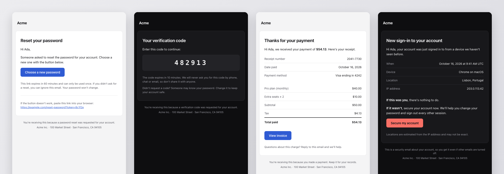

<p align="center">
  <a href="https://groundmail.dev">
    <picture>
      <source media="(prefers-color-scheme: dark)" srcset="https://app.groundmail.dev/images/github/readme-logo-dark.png">
      
    </picture>
  </a>
</p>

<h1 align="center">Transactional email templates</h1>

<p align="center">
  12 production-ready emails for auth, account and billing.<br>
  React Email, MJML, HTML and plain text. Light and dark mode. Restyle everything from one theme file.
</p>

<p align="center">
  <a href="./LICENSE"></a>
  <a href="https://github.com/Groundmail/email-templates/actions/workflows/ci.yml"></a>
  
</p>

<p align="center">
  <a href="https://groundmail.github.io/email-templates/"><b>Live preview</b></a> ·
  <a href="https://docs.groundmail.dev/guides/email-templates">Docs</a> ·
  <a href="https://app.groundmail.dev/signup">Get a free account</a>
</p>

---

<p align="center">
  <a href="https://groundmail.github.io/email-templates/"></a>
</p>

Free to use with any email provider or framework. Copy one file or the whole set; no attribution needed.

## Templates

| | Template | What it's for |
|-|----------|---------------|
| **Auth** | [Password reset](templates/password-reset) | Single-use link to choose a new password |
| | [Magic link](templates/magic-link) | Passwordless sign-in |
| | [Email verification](templates/email-verification) | Confirm an address after sign-up or an email change |
| | [One-time code](templates/one-time-code) | 2FA, sign-in or checkout codes |
| **Account** | [Welcome](templates/welcome) | First email after sign-up |
| | [Team invite](templates/team-invite) | Invite someone to a team or workspace |
| | [New sign-in alert](templates/new-sign-in) | Security alert for a sign-in from a new device |
| | [Account deletion](templates/account-deletion) | Confirms a deletion request, with a grace period to restore |
| **Billing** | [Receipt](templates/receipt) | Payment receipt with line items, tax and total |
| | [Payment failed](templates/payment-failed) | Declined card, retry date and one fix button |
| | [Subscription renewal](templates/subscription-renewal) | Upcoming renewal reminder |
| | [Usage alert](templates/usage-alert) | Warning before a plan limit, with a progress bar |

Every template folder has the same files:

| File | What it is |
|------|------------|
| `<name>.tsx` | [React Email](https://react.email) component with typed props |
| `<name>.mjml` | [MJML](https://mjml.io) source that compiles on its own |
| `<name>.html` | Ready-to-send HTML with `{{variable}}` placeholders |
| `<name>.txt` | Plain-text part with the same placeholders |
| `README.md` | Variables, plus send code for Node, Python, PHP and cURL |

## Quick start

```bash
git clone https://github.com/Groundmail/email-templates.git
cd email-templates
npm install
npm run dev        # React Email preview at http://localhost:3000
```

**React Email.** Copy `theme.ts`, `components/` and the template folders you need into one folder in your app (say `emails/`), keeping the same layout, then render:

```tsx
import { render } from 'react-email'
import PasswordReset, { text } from './emails/templates/password-reset/password-reset'

const props = { name: 'Ada', resetUrl: 'https://yourapp.com/reset?token=…', expiresIn: '60 minutes' }
const html = await render(<PasswordReset {...props} />)
const plain = text(props)
```

**HTML.** The `.html` and `.txt` files use plain `{{variable}}` placeholders, which Handlebars, Mustache, Liquid-style engines and most email APIs fill as-is.

**MJML.** Each file is standalone:

```bash
npx mjml templates/password-reset/password-reset.mjml -o password-reset.html
```

## Make them yours

Everything brand-specific lives in [`theme.ts`](theme.ts): product name, logo (with an optional dark-mode logo), address, fonts, corner radius, and a light and dark palette.

```ts
export const theme = {
  brand: { name: 'Acme', logoUrl: 'https://yourapp.com/email-logo.png', websiteUrl: 'https://yourapp.com', … },
  radius: 8,
  colors: {
    light: { page: '#f4f4f5', card: '#ffffff', text: '#18181b', accent: '#2f5bd3', … },
    dark: { page: '#0e0e10', card: '#18181b', text: '#f4f4f5', accent: '#7a9bff', … },
  },
}
```

Run `npm run build` and the React components, the generated HTML and text, and the theme blocks inside every `.mjml` file all update. Copy edits go in the `.tsx` (and the matching `.mjml`); the build regenerates everything else.

## Send them with Groundmail

Create all 12 in your account (each becomes a published template keyed by its folder name), then send by alias:

```bash
export GROUNDMAIL_API_KEY=gm_your_key_here   # needs the templates:write scope
npm run push -- --all                          # or: npm run push -- password-reset receipt
```

```ts
import { Groundmail } from 'groundmail'

const groundmail = new Groundmail(process.env.GROUNDMAIL_API_KEY!)

await groundmail.emails.send({
  from: 'Acme <noreply@yourdomain.com>',
  to: 'ada@example.com',
  template: {
    id: 'password-reset',
    variables: { name: 'Ada', reset_url: 'https://yourapp.com/reset?token=…', expires_in: '60 minutes' },
  },
})
```

No clone needed for a single template: each folder's README has a two-line `curl` that creates it straight from this repo, plus the same send in Python, PHP and cURL. Or skip hosted templates and pass the component directly with `react: <PasswordReset … />`.

## Dark mode and email client support

The light design is always inline, so a client that strips `<style>` still shows a finished email. Dark mode and small-screen tweaks are layered on top.

| Client | What you get |
|--------|--------------|
| Apple Mail, iOS Mail, Outlook for Mac | Full dark palette from `theme.ts` |
| Outlook.com | Dark palette through its `[data-ogsc]`/`[data-ogsb]` hooks |
| Gmail (web, iOS, Android) | Gmail ignores author dark styles and inverts colors itself; the light palette is chosen to invert cleanly |
| Outlook for Windows (classic) | Square corners (no `border-radius`) and no dark styles; table layout and buttons render correctly |
| Yahoo Mail, AOL, Samsung Email | Light design; dark mode varies by app |

What CI checks on every change:

- Every HTML output is checked against [caniemail](https://www.caniemail.com) data (via `doiuse-email`) for Gmail, Outlook, Apple Mail, Yahoo and Samsung Email. Only known progressive enhancements are allowed; flexbox, grid, CSS variables, web fonts and scripts fail the build.
- MJML compiles with strict validation, and the React Email and MJML versions use the same variables.
- Every email stays under Gmail's 102 KB clipping limit (the largest is about 28 KB).
- Generated HTML, text and MJML theme blocks match `theme.ts`.

The templates have not been screenshot-tested in Litmus or Email on Acid yet. If a client renders one badly, an issue with a screenshot is very welcome.

## Development

```bash
npm run dev          # React Email preview server
npm run build        # regenerate .html, .txt, groundmail.json, READMEs and MJML theme blocks
npm run build:site   # also build the preview site into site/dist
npm test             # rendering, parity, size and client-compatibility checks
```

Adding a template: create `templates/<name>/<name>.tsx` and `<name>.mjml` (copy an existing pair), add the name to `scripts/registry.ts`, then run `npm run build` and `npm test`.

## Why Groundmail

- **Our own mail servers and IP space.** Your password resets and receipts don't share a pool with bulk marketing senders.
- **Transactional email only.** No newsletters or cold outreach on the platform, which keeps the sending reputation clean.
- **Start free.** 3,000 emails a month on the Free plan; Pro is 50,000 emails for $20/month. Dedicated IPs on Scale.
- **Built for code and for agents.** REST API, SMTP, SDKs for Node, Python, Go, PHP and Ruby, a CLI, and an MCP server for Claude, ChatGPT and Cursor.

## All Groundmail libraries

| Use | Package |
|-----|---------|
| Node.js / TypeScript | [`groundmail`](https://www.npmjs.com/package/groundmail) on npm |
| Python, Go, Ruby | [Groundmail/groundmail-sdks](https://github.com/Groundmail/groundmail-sdks) |
| PHP | [Groundmail/groundmail-php](https://github.com/Groundmail/groundmail-php) |
| Laravel | [Groundmail/groundmail-laravel](https://github.com/Groundmail/groundmail-laravel) |
| Symfony Mailer | [Groundmail/groundmail-symfony-mailer](https://github.com/Groundmail/groundmail-symfony-mailer) |
| Nodemailer | [Groundmail/groundmail-nodemailer](https://github.com/Groundmail/groundmail-nodemailer) |
| NestJS | [Groundmail/nestjs-groundmail](https://github.com/Groundmail/nestjs-groundmail) |
| Strapi | [Groundmail/strapi-provider-email-groundmail](https://github.com/Groundmail/strapi-provider-email-groundmail) |
| Medusa | [Groundmail/medusa-notification-groundmail](https://github.com/Groundmail/medusa-notification-groundmail) |
| AdonisJS | [Groundmail/adonisjs-groundmail](https://github.com/Groundmail/adonisjs-groundmail) |
| CLI | [`groundmail-cli`](https://www.npmjs.com/package/groundmail-cli) on npm |
| MCP server (Claude, ChatGPT, Cursor) | [Groundmail/groundmail-mcp](https://github.com/Groundmail/groundmail-mcp) |
| Agent skills and Claude Code plugin | [Groundmail/groundmail-skills](https://github.com/Groundmail/groundmail-skills) |
| Email templates (React Email, MJML, HTML) | [Groundmail/email-templates](https://github.com/Groundmail/email-templates) |

[Website](https://groundmail.dev) · [Docs](https://docs.groundmail.dev) · [Pricing](https://groundmail.dev/pricing) · [Sign up free](https://app.groundmail.dev/signup)
